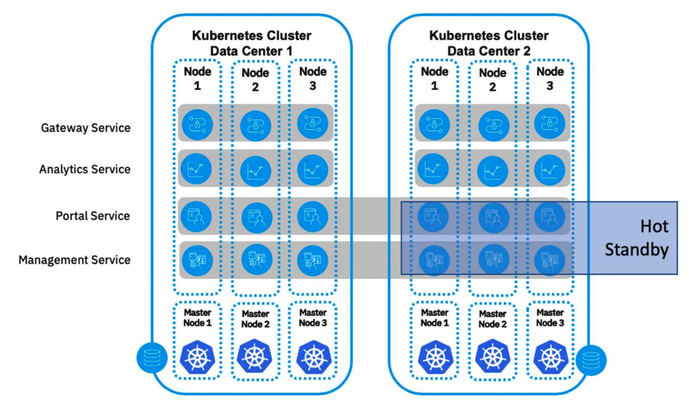
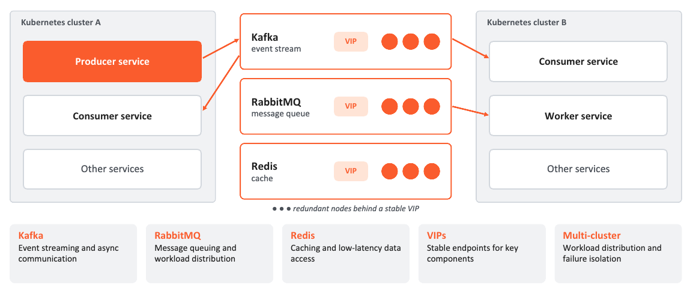
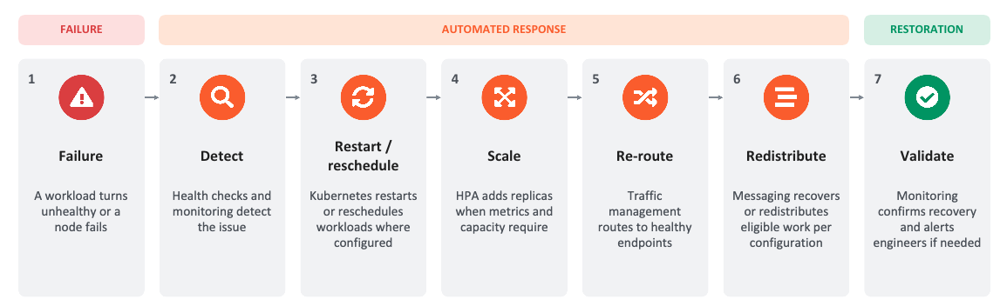

# Proposed architecture

## Primary data center — DC1

**HAProxy / Keepalived** - API VIP and traffic entry

**3 control planes** - kubeadm / etcd HA

**Worker nodes** - Application workloads

Replication · Health checks · Traffic failover

## Disaster recovery data center — DC2

**DR load balancer** - API / application entry

**DR Kubernetes** - Independent cluster 

**DR workloads** - Replicated application state

# **Event-Driven Architecture and Distributed Resilience**

# **Self Healing in Action**

